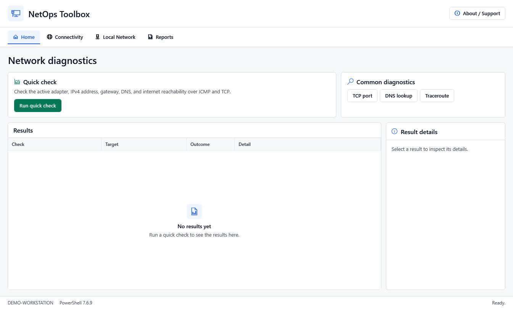
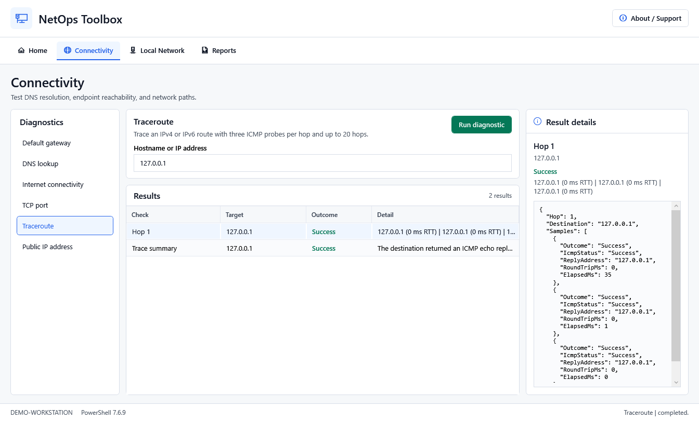
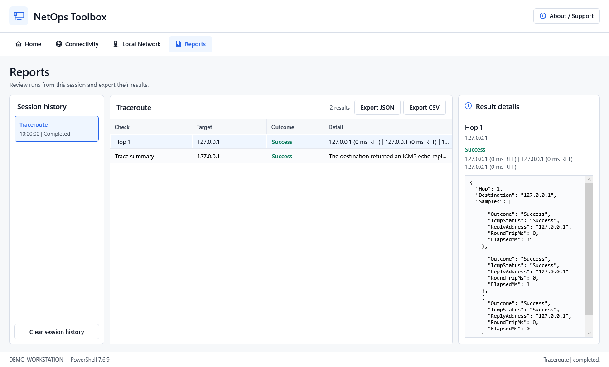

# NetOps Toolbox

<p align="center">
  
</p>

<p align="center">
  
  
  
  
  
</p>

NetOps Toolbox is a white-label PowerShell and WPF application for diagnosing network issues on Windows. Run a quick check, inspect individual results, and export your diagnostic session as JSON or CSV.

## Requirements

- Windows 10 or 11 with an interactive desktop.
- PowerShell 7.6 LTS for Windows is recommended. The launcher declares a minimum of 7.4 and uses a single-threaded apartment (STA) for WPF.
- The built-in Windows `NetAdapter`, `NetTCPIP`, and `DnsClient` modules and the Windows WLAN service for their respective diagnostics.

Run under your normal Windows account. A diagnostic reports unavailable data if Windows, device policy, or a disabled service prevents access.

## Download and Start

### Download the ZIP

1. Open [Releases](https://github.com/dbevilacqua-tech/NetOpsToolbox/releases/latest) and download **Source code (zip)**.
2. Extract the complete archive to a local folder. If Windows blocks a trusted download, follow your organization’s policy for unblocking it.
3. Open PowerShell 7 in the extracted folder and run:

```powershell
.\NetOpsToolbox.ps1
```

### Clone with Git

```powershell
git clone https://github.com/dbevilacqua-tech/NetOpsToolbox.git
Set-Location .\NetOpsToolbox
pwsh -NoProfile -STA -File .\NetOpsToolbox.ps1
```

Keep the supplied [`config.example.json`](Config/config.example.json) with the application. Its defaults are ready to use. See [First Configuration](#first-configuration) for optional changes.

## Features

| Workspace | Checks |
| --- | --- |
| Home | **Quick check** reviews active physical adapters, usable non-link-local IPv4 addresses, the default gateway, DNS, public ICMP, and TCP. |
| Connectivity | **Default gateway**, **DNS lookup**, **Internet connectivity**, **TCP port**, **Traceroute**, and **Public IP address**. |
| Local Network | **Network adapters**, **Local IP addresses**, **ARP table**, **Routing table**, **TCP connections**, **Wi-Fi interfaces**, and **Configured DNS servers**. |
| Reports | Inspect completed, cancelled, and timed-out runs. Export the session as **JSON** or **CSV**. |

Select a result row to inspect its details and structured data. TCP port and traceroute accept a DNS name or IP address. Enter a TCP port between 1 and 65535 in the separate port field. Leave the DNS name blank to query the configured default names.

Diagnostics run in the background one at a time. You can browse workspaces or select **Cancel diagnostic** while a run is active. Closing the window cancels the active worker. Completed checks and traceroute hops can remain available after an interrupted run.

## Screenshots

### Quick check

<p align="center">
  
</p>

### Traceroute and result details

<p align="center">
  
</p>

### Session reports and export

<p align="center">
  
</p>

## First Configuration

Create `Config\config.local.json` only if you want to change branding, theme colors, diagnostic settings, or logging.

```powershell
Copy-Item .\Config\config.example.json .\Config\config.local.json
notepad .\Config\config.local.json
```

The local file overrides the example and can contain only the keys you want to change. Git ignores the local file. Restart the application after editing it. **About / Support** shows the active configuration path, log path, and configured probe targets.

### White-label Adaptation

- Set `Application.Name`, `Application.Company`, and `Application.Version` to control the visible product identity. Leave `Company` empty to hide the company line.
- Use `Branding.UseLocalLogo` and `Branding.LogoPath` to load a local image. A transparent or white PNG around 400 × 220 pixels fits the header. Paths can be drive-qualified or relative to the project folder, such as `Assets/logo.png`. A missing or unreadable logo uses the neutral Windows network icon.
- Use six-digit `#RRGGBB` values for `Theme.AccentColor`, `Theme.AccentBackgroundColor`, `Theme.PrimaryActionColor`, and `Theme.WorkspaceBackgroundColor`.

### Diagnostic and Logging Settings

Keys in the diagnostics rows belong to the `Diagnostics` object.

| Setting | Behavior |
| --- | --- |
| `DnsTargets` | One to five DNS names for the default DNS lookup. Quick check uses the first. |
| `InternetIcmpAddress`, `InternetTcpHost`, `InternetTcpPort` | Internet-probe destinations. The defaults are `1.1.1.1` and `www.msftconnecttest.com` on TCP port 80. |
| `PublicIpEndpoints` | One to three HTTPS URLs in fallback order. A service can return an IP as plain text or as the `ip` field of a JSON object. Each requested service sees the request’s source address. |
| `PingTimeoutMs`, `TraceTimeoutMs` | Per-probe limits of 200–2,000 ms and 200–1,000 ms respectively. A trace uses up to 20 hops with three probes per hop. |
| `ConnectTimeoutSeconds`, `PublicIpTimeoutSeconds` | TCP and trace name resolution use a budget of 1–15 seconds. The public IP timeout is 1–10 seconds per endpoint. Whole-run limits are 25–85 seconds, depending on the tool. |
| `Logging.Enabled`, `Logging.LocalLogFolder` | Write completed runs and partial results as JSON Lines. The default folder is `%LOCALAPPDATA%\NetOpsToolbox\Logs`. Local paths support Windows environment variables. |

Public probes run on demand. Change the destinations to suit your network. Public IP lookup runs separately from Quick check.

## Diagnostic Scope and Outcomes

Address, route, and DNS server inventories cover IPv4 and IPv6. TCP inventory lists up to 60 established connections with PID and process name where available. NetOps Toolbox reads network state and sends diagnostic probes. DHCP changes, DNS cache flushing, adapter restarts, and Winsock or TCP/IP resets require separate administration tools.

- **No reply** means the probe received no ICMP echo reply within the time limit. Filtering and silent hosts can produce the same outcome. Traceroute continues across silent hops and labels elapsed time and echo round-trip time individually.
- **Unreachable** reports an explicit ICMP or socket indication. **Refused** reports an active TCP refusal. **Timed out** can reflect filtering, loss, or a slow response.
- **Success** applies to the tested endpoint and protocol. A TCP success confirms a handshake. A public IP result can reflect NAT, a VPN, or a proxy.
- DNS lookup queries A records through the Windows DNS client and can use cached results. TCP and traceroute use the system host resolver and can also use IPv6.
- The gateway check selects a connected IPv4 default route using route plus interface metrics. An on-link default has no separate gateway to ping.
- Wi-Fi results use English labels. Windows location policy can restrict SSID and BSSID access. Interface names, profile names, and SSIDs appear as supplied by Windows. System dialogs follow the Windows display language.

## Reports and Logs

Choose **Export JSON** for the full session structure, including nested probe and inventory data. **Export CSV** writes one row per result with a `DataJson` column. Run state describes execution, while each result records its diagnostic outcome.

The first completed diagnostic creates a JSON Lines log for the current session. Use **About / Support** to open the log folder. **Clear session history** clears the results and history in memory. Saved logs and reports are independent files.

Logs and exports may contain internal IP addresses, hardware addresses, Wi-Fi details, and process names. Use sample data or redact those values before sharing a report or screenshot publicly.

## Project Layout

```text
NetOpsToolbox.ps1          Main WPF launcher
Config/config.example.json  Default settings and branding template
Modules/                   Configuration, diagnostics, and background workers
Views/MainWindow.xaml      WPF workspace and result layout
docs/images/               README banner and screenshots
```

## Validation

Validation was run on Windows 11 Pro (build 26300) with PowerShell 7.6.9 under a standard user. It covered configuration, target validation, WPF startup, cancellation, timeouts, application close cleanup, and JSON and CSV export. Live checks covered local inventory, Quick check, gateway ICMP, DNS success and name-not-found, IPv4 traceroute, IPv6 loopback, TCP success and refusal, and HTTPS public IP fallback. Wi-Fi interface and radio status were verified on a disconnected adapter. Active connection and location-denial results were checked with simulated WLAN data.

Windows 10, PowerShell 7.4/7.5, routed IPv6 traceroute, live Wi-Fi association and location denial, and manual interaction with native Save dialogs remain untested.

See the [changelog](CHANGELOG.md) for release history.

## License

See [LICENSE](LICENSE).
